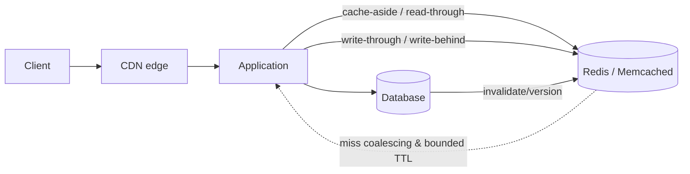

# Module 7 — Caching

A source-linked, runnable Java 21 learning module. Each roadmap topic has its own directory with a guide, standalone example, and focused JUnit tests. Examples are local simulations—no broker, database, cloud account, or credential is required.

## Roadmap coverage map

| Roadmap topic | Explicit subtopics | Topic folder | Guide | Runnable example | Tests |
|---|---|---|---|---|---|
| Caching Strategies | Cache-Aside; Write-Through; Write-Behind; Read-Through | [`topics/strategies/`](topics/strategies/) | [guide](topics/strategies/README.md) | [example](topics/strategies/src/main/java/Example.java) | [tests](topics/strategies/src/test/java/ExampleTest.java) |
| Cache Eviction Policies | LRU; LFU; TTL | [`topics/eviction/`](topics/eviction/) | [guide](topics/eviction/README.md) | [example](topics/eviction/src/main/java/Example.java) | [tests](topics/eviction/src/test/java/ExampleTest.java) |
| Distributed Caching | Redis; Memcached | [`topics/distributed-caching/`](topics/distributed-caching/) | [guide](topics/distributed-caching/README.md) | [example](topics/distributed-caching/src/main/java/Example.java) | [tests](topics/distributed-caching/src/test/java/ExampleTest.java) |
| CDN | Content Delivery Network | [`topics/cdn/`](topics/cdn/) | [guide](topics/cdn/README.md) | [example](topics/cdn/src/main/java/Example.java) | [tests](topics/cdn/src/test/java/ExampleTest.java) |
| Cache Invalidation | Cache Invalidation | [`topics/invalidation/`](topics/invalidation/) | [guide](topics/invalidation/README.md) | [example](topics/invalidation/src/main/java/Example.java) | [tests](topics/invalidation/src/test/java/ExampleTest.java) |
| Cache Stampede & Thundering Herd | Cache Stampede; Thundering Herd | [`topics/stampede/`](topics/stampede/) | [guide](topics/stampede/README.md) | [example](topics/stampede/src/main/java/Example.java) | [tests](topics/stampede/src/test/java/ExampleTest.java) |
| Application-Level vs Database-Level Caching | Application-Level; Database-Level | [`topics/cache-layers/`](topics/cache-layers/) | [guide](topics/cache-layers/README.md) | [example](topics/cache-layers/src/main/java/Example.java) | [tests](topics/cache-layers/src/test/java/ExampleTest.java) |
## Architecture



The diagram is conceptual; every topic guide distinguishes the model from the limits of its in-memory example.

## Run and test

Requires a Java 21 toolchain (Gradle can use an installed JDK or a configured toolchain resolver).

```sh
./gradlew test
./gradlew runExample -Pexample=<fully-qualified-class-from-topic-guide>
./gradlew runAllExamples
```

Each topic guide provides its example’s exact fully qualified class name; package names are descriptive and need not mirror the directory name. Tests are intentionally offline apart from resolving the pinned JUnit dependency the first time Gradle runs.

## Trade-offs and anti-patterns

Cache only data with a clear source of truth, freshness bound, key, owner, and failure policy. Measure hit rate and origin load; model stampedes and invalidation before tuning TTL.

- Avoid selecting a technology before identifying consistency, latency, durability, failure, and operational requirements.
- Avoid hiding stale reads, duplicate delivery, unbounded work, or schema changes behind a “best effort” abstraction.
- Examples are educational models, not production-ready clients or claims of vendor equivalence; follow the linked product documentation for configured guarantees.

## References

Topic guides link directly to primary vendor documentation and, where appropriate, a foundational paper/specification. Product behavior is version- and configuration-dependent; verify guarantees against the deployed version.
